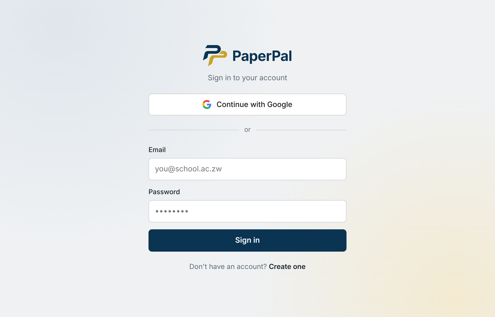
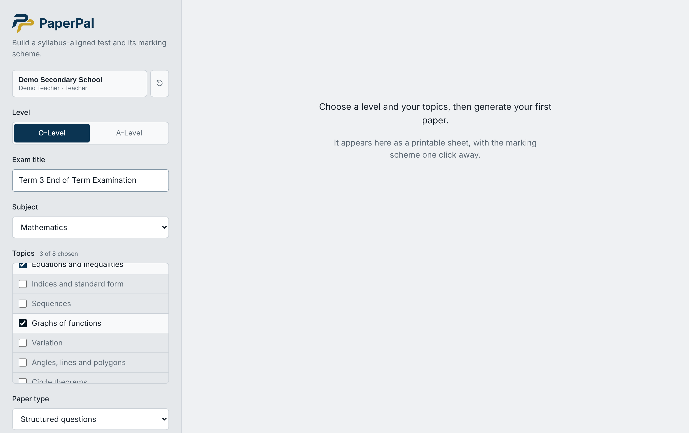
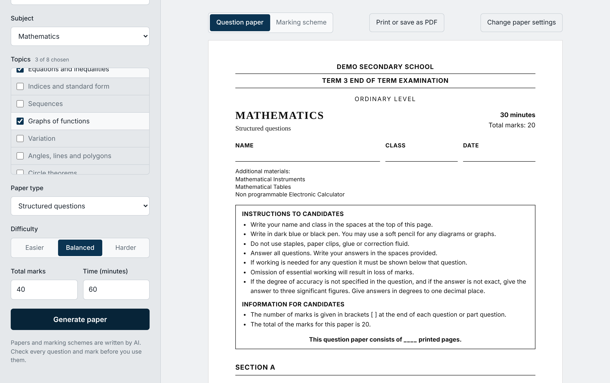
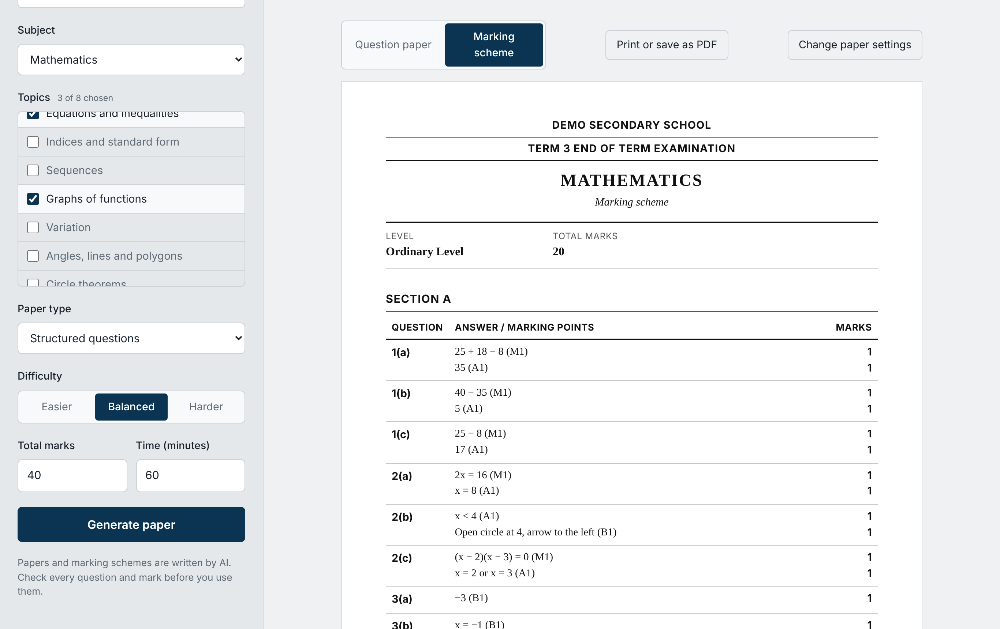

# PaperPal

PaperPal helps Zimbabwean secondary school teachers generate ZIMSEC-style test papers and full marking schemes in minutes. A teacher picks the level, subject, topics, paper type, difficulty, marks and time, and PaperPal writes the paper and the marking scheme, which the teacher reviews and prints.

**Live app:** https://paperpal-alpha.vercel.app  
**Code:** https://github.com/munyaradzichakwenya60-coder/paperpal

This is the capstone project for the Uncommon.org software development track. The approved proposal is "Capstone Proposal – Munyaradzi – PaperPal".

## Screenshots

Taken from the running app. The generated paper shown here is a sample paper served by a stubbed API so the screens can be captured without spending AI quota; the layout, cover page, instructions and diagram rendering are the real app.

| | |
|---|---|
|  |  |
|  |  |
|  |  |

## Features

- Sign up and login with email and password, or Google (Supabase Auth)
- Paper builder for O-Level and A-Level, 20 subjects, with syllabus topic lists per subject
- Paper types: structured, multiple choice, mixed, and sectioned (ZIMSEC 4004/2 style, 100 marks)
- Difficulty (easier, balanced, harder), total marks and time
- AI generation of a paper and full marking scheme (M, A and B marks, AO1 to AO3), checked by strict validation and retried or repaired when a check fails
- 12 diagram types drawn by the app from AI descriptions (sets, triangles, number lines, grids, bar charts, circles, tables, annuli, inequalities, solids, bearings, function graphs)
- School profile (school, teacher, role) printed on the paper cover and saved to the teacher's account
- Papers saved to the teacher's account; history of the last 50
- Question paper and marking scheme views, print or save as PDF
- Mock mode with sample papers when no AI key is set
- Mobile-friendly layout; ZIMSEC-style navy, grey and gold branding with an animated splash
- 30 automated tests (validation, retry and repair, input checks, rate limiting, API)

## Tech stack

- Frontend: React 18, TypeScript, Vite, React Router
- Backend: Node.js 20+, Express, TypeScript, Zod
- Database and auth: Supabase (Postgres with row level security, Auth)
- AI: Google Gemini API (primary), OpenRouter (backup), called only from the server
- Hosting: Vercel (static client and one serverless function in `api/`)
- Tests: Node's built-in test runner

## Setup

Requires Node.js 20 or newer and a Supabase project.

```bash
npm install
cp server/.env.example server/.env
```

1. In Supabase, run `supabase/migrations/001_init.sql` (tables `profiles` and `papers`, owner-only policies, signup trigger). Enable Email and Google providers under Authentication.
2. Edit `server/.env`: `GEMINI_API_KEY`, `SUPABASE_URL`, `SUPABASE_SERVICE_ROLE_KEY`. Optional: `OPENROUTER_API_KEY`, `OPENROUTER_MODEL`, `GEMINI_MODEL`, `GEMINI_FALLBACK_MODEL`, `AI_PROVIDER` (`gemini`, `openrouter` or `mock`), `AI_TIME_BUDGET_MS`.
3. For the client, create `client/.env` with `VITE_SUPABASE_URL` and `VITE_SUPABASE_ANON_KEY` (the public anon key only).

Never commit `.env` files. Without any AI key the app runs in mock mode and returns sample papers.

## Run

```bash
npm run dev         # API on :3001 and the client on :5173, client proxies /api
npm test            # server unit tests (30)
npm run typecheck   # server and client
npm run build       # production build
npm start           # serve the API and built client from one process
```

Open http://localhost:5173 while developing.

## Deployment (Vercel)

1. Import the GitHub repo in Vercel. `vercel.json` sets the build, output folder, routes and security headers.
2. Add the environment variables above (server keys as normal variables; `VITE_SUPABASE_*` so the client build can read them).
3. Deploy. `/api/health` reports the active AI provider.

Generating a paper can take 10 to 60 seconds, so the function has a 300 second limit and the AI loop stops at a 270 second budget.

## AI integration

See [docs/AI_INTEGRATION.md](docs/AI_INTEGRATION.md) for the full description, [docs/RESPONSIBLE_AI.md](docs/RESPONSIBLE_AI.md) for the ethics statement and [docs/PROMPTS.md](docs/PROMPTS.md) for the prompts. In short:

- **APIs:** Google Gemini `generateContent` (`gemini-2.5-flash`, then lighter `gemini-2.5-flash-lite` when it is busy), with OpenRouter as a backup when Gemini quota runs out.
- **What it does:** turns the teacher's settings into a complete paper and marking scheme as structured JSON.
- **Safeguards:** schema check, mark totals, marking scheme sums, four options per multiple-choice question, diagram checks, automatic repair of small mark slips, and retries that feed the problems back to the model.
- **Limitations:** the model can be wrong, has no official ZIMSEC syllabus or past papers, and every paper must be reviewed by the teacher.

## Data and privacy

- No student names or personal details are needed or collected.
- Only the chosen subject, topics and settings are sent to the AI provider, never the teacher's name, school or email.
- Teacher accounts, school profile and generated papers are stored in Supabase, protected by row level security so each teacher can only read their own rows.
- API keys and the Supabase service role key stay on the server.

## Project structure

```
api/        Vercel serverless entry point (re-exports the shared Express app)
client/     React app (splash, auth, builder, paper and marking scheme views)
server/     Express app, prompt, AI providers, validation, diagrams, rate limiting, tests
supabase/   Database migration
docs/       AI integration description, responsible AI statement, screenshots
```
